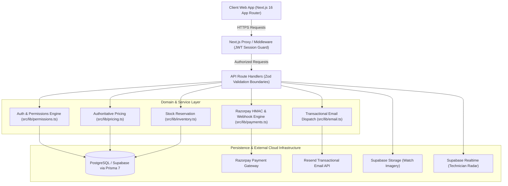

# System Architecture: Wristloom
**Layer 2: System Architecture (15-Layer SaaS Playbook, p. 6-7)**

## 1. High-Level Architectural Pattern
Wristloom is architected as a **Modern Modular Monolith** built on Next.js 16 (App Router) and deployed serverlessly.
Rather than operating fragile distributed microservices, all routing, API boundaries, business domain logic, and client interfaces live within a unified, strictly modular repository.

---

## 2. Component Topology (Mermaid Diagram)

---

## 3. Technology Stack & Rationale

| Layer | Chosen Technology | Evaluated Alternative | Rejection Rationale |
|---|---|---|---|
| **Frontend Framework** | Next.js 16 (React 19, Turbopack) | Remix / Vite SPA | Next.js App Router provides unified SSR, SSG for boutique marketing pages, and co-located Edge API routes. |
| **Styling** | Tailwind CSS v4 + Radix UI | Styled Components | Tailwind v4 provides instant compile times, atomic CSS bundling, and zero runtime CSS overhead. |
| **Database & ORM** | PostgreSQL (Supabase) + Prisma 7 | MongoDB + Mongoose | Luxury horology requires strict relational constraints (orders, order items, foreign keys, cascade safety). |
| **Authentication** | NextAuth.js v5 (JWT Strategy) | Hand-rolled JWT / Custom Auth | Established library eliminates custom cryptography vulnerabilities and handles OAuth rotation safely. |
| **Payments** | Razorpay (India & Global Cards/UPI) | Stripe | Razorpay provides native Indian UPI, RuPay, and NetBanking support alongside international cards. |
| **Email Delivery** | Resend API | Nodemailer / Self-hosted SMTP | Resend delivers high deliverability, native React email templating, and zero SMTP server maintenance. |

---

## 4. Background Jobs & Asynchronous Work
- **Payments & Webhooks**: Handled asynchronously via idempotent webhook ingestion at `/api/payments/webhook`.
- **Customer Notifications**: In-app notifications are dispatched asynchronously via non-blocking database writes (`.catch(console.warn)`).
- **Email Delivery**: Dispatched out-of-band via Resend REST API.

---

## 5. Third-Party Services & Monthly Cost Estimate

| Service | Role | Launch Cost | Cost at 10x Scale |
|---|---|---|---|
| **Vercel** | Frontend & Serverless Hosting | $20/month (Pro) | ~$40/month |
| **Supabase** | Managed PostgreSQL, Auth, Realtime, Storage | $25/month (Pro) | ~$50/month |
| **Razorpay** | Payment Gateway | 2% per transaction | 2% (scales with GMV) |
| **Resend** | Transactional Email | $0/month (Free tier, 3k/mo) | $20/month |
| **Google Maps** | Distance Matrix & Map SDK | Free tier ($200 credit/mo) | ~$50/month |
| **Total Base Ops** | | **~$45/month** | **~$160/month** |

---

## 6. The Three Riskiest Architectural Decisions

1. **Serverless Ephemeral Memory for Rate Limiting**:
   - *Risk*: In-memory sliding window counters reset across cold starts on serverless function instances.
   - *Mitigation*: Upgraded rate limiter to calculate `Retry-After` headers; Upstash Redis integration planned when concurrent abuse volume justifies distributed cache.
2. **Real-Time Technician Telemetry Frequency**:
   - *Risk*: Flooding database with high-frequency GPS ping writes.
   - *Mitigation*: Use Supabase Realtime broadcast channels for transient GPS radar updates; write to `TechnicianLocation` only on significant movement or milestone arrival.
3. **Double Stock Allocation During Simultaneous Checkouts**:
   - *Risk*: Two collectors buying the same unique vintage timepiece concurrently.
   - *Mitigation*: Atomic `verifyAndReserveInventory` transaction in `src/lib/inventory.ts` that checks stock before order generation and atomically decrements on payment verification.
